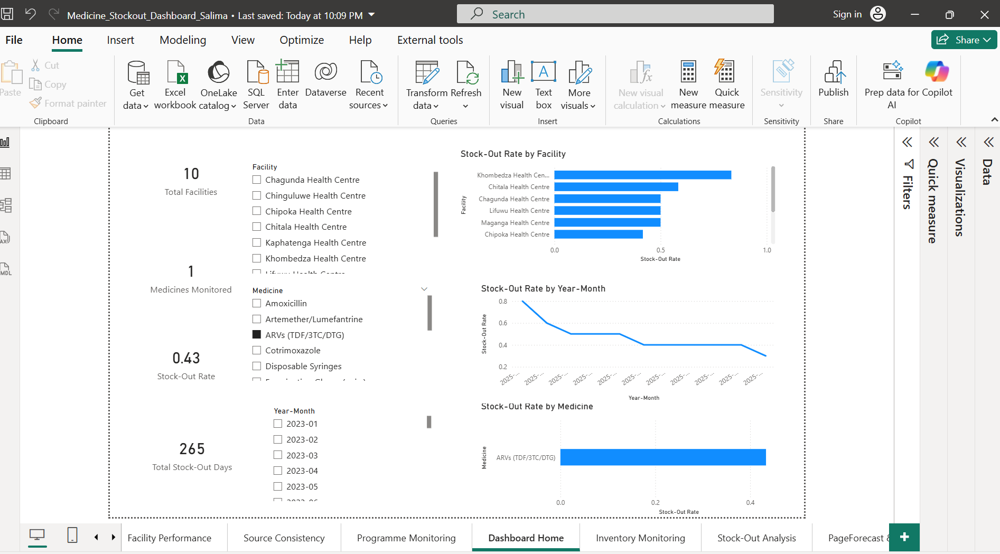

# Malawi Medicine Stock-Out Analytics Platform

A portfolio project for exploring medicine inventory, reporting quality, and stock-out risk across a district-level health-facility case study in Malawi. The repository now brings together an exploratory Jupyter analysis, a reusable Python workflow, a Streamlit application, SQL examples, and a Power BI dashboard.

The project is intended to demonstrate how stock movement records can be checked and translated into inventory indicators for review. It is not an operational supply-chain system, and its results must not be interpreted as actual medicine availability.

## Project Goals

The analysis and tools address questions such as:

- Which facility-medicine combinations have the lowest stock coverage?
- Which records violate expected inventory accounting or need data-quality review?
- How do lead time, safety stock, and consumption relate to simple reorder guidance?
- How do alternative demand and delivery assumptions change the simulated inventory picture?
- How can results be explored in a notebook, CSV workflow, Streamlit app, or Power BI report?

## What Is Included

| Area | Current implementation |
| --- | --- |
| Exploratory analysis | Jupyter notebook, a processed monthly summary, and exported analytical charts |
| Data generation | Reproducible daily ledger generator with baseline, delayed-delivery, high-demand, and improved-policy outputs |
| Data quality | Ledger validation for required columns, duplicate keys, invalid dates, negative balances, and accounting discrepancies |
| Inventory analytics | Days-of-stock, stock status, reorder point, and reorder quantity calculations |
| Baseline model | Logistic-regression example trained from the generated summary data |
| Python interface | Streamlit app for browsing generated ledgers by facility and medicine |
| BI deliverable | Power BI `.pbix` file, page screenshots, and dashboard documentation |
| SQL examples | Example queries for risk ranking, stock-out days, delivery delays, and reorder review |
| Automated checks | Pytest coverage for core inventory calculations and ledger validation |

The repository contains two related data workflows. `data/raw/` and `data/processed/` support the original notebook analysis. `data/generated/` contains files produced by the newer Python generator and is the input expected by the command-line analysis and Streamlit app.

## Data and Interpretation

All stock balances, issues, receipts, delivery behavior, reporting patterns, and calculated outcomes are synthetic. Facility and medicine labels provide context for the demonstration; the figures do not describe actual facility performance. Do not use this dataset to make procurement, treatment, staffing, or patient-care decisions.

The ledger includes facility, medicine, date, opening stock, receipts, issues, adjustments, losses, closing stock, lead time, safety stock, target stock, and a reporting indicator. The intended accounting check is:

```text
Closing stock = Opening stock + Receipts + Adjustments - Issues - Losses
```

The validator reports discrepancies against this identity; it does not repair the records. The scenario CSVs are simple scenario transformations of the generated baseline, not full supply-chain re-simulations. In particular, transformed scenario rows may no longer balance under the ledger identity, so validate a scenario before treating its derived indicators as meaningful.

The generated analysis output is an enriched row-level ledger with derived indicators; despite the `build_monthly_summary` function name, that command does not aggregate daily records into a monthly table. The separate `data/processed/monthly_stock_summary_clean.csv` is the monthly table used by the notebook-era analysis.

## Repository Map

```text
app/
	main.py                         Streamlit stock-out decision-support view
data/
	raw/                            Notebook-era synthetic daily ledger
	processed/                      Notebook-era monthly analytical table
	generated/                      CLI-generated baseline and scenario ledgers
	quality/                        Validation report output
docs/                             Methodology, architecture, audit, and data notes
dashboard/                        Power BI report, exported page images, and guide
models/                           Saved baseline classifier artifact
notebooks/                         Exploratory analysis notebook
outputs/                           Generated analysis summary CSV
sql/                               Example analytical SQL queries
src/
	analytics/                       Inventory calculations and analysis command
	data/                            Synthetic data generation and validation
	models/                          Baseline model training and evaluation
tests/                              Automated inventory-core tests
visuals/charts/                    Notebook-era analytical chart exports
```

## Setup

Run commands from the repository root (the directory containing `requirements.txt`):

```powershell
python -m venv .venv
.\.venv\Scripts\Activate.ps1
python -m pip install --upgrade pip
python -m pip install -r requirements.txt
```

On macOS or Linux, activate the environment with `source .venv/bin/activate` instead. Python 3.10 or newer is recommended for the syntax used by the source files.

## Reproduce the Python Workflow

Generate four synthetic ledger files with the default seed:

```bash
python -m src.data.generate --output-dir data/generated --seed 42
```

Validate the baseline and write a CSV of reported issues:

```bash
python -m src.data.validate data/generated/baseline_inventory_ledger.csv --output data/quality/validation_issues.csv
```

Build the row-level analysis output:

```bash
python -m src.analytics.run_analysis --input data/generated/baseline_inventory_ledger.csv --output outputs/summary.csv
```

Train the baseline classifier and run its current evaluation command:

```bash
python -m src.models.train --input outputs/summary.csv --output-dir models/
python -m src.models.evaluate --input outputs/summary.csv --model models/baseline_logistic_regression.joblib
```

Run the automated tests:

```bash
python -m pytest -q
```

The generator defaults to seed `42`; pass another integer to create a different deterministic run. The validation and analysis commands accept explicit input and output paths, so generated artifacts can be kept separate when comparing runs.

## Open the Streamlit App

Generate the input data first, then start the app from the repository root:

```bash
streamlit run app/main.py
```

The app lets a user select a generated ledger, facility, and medicine. It displays the latest row's closing stock, days of stock, and status, alongside a recent movement table. It is a compact review interface, not a forecasting service or a replacement for inventory-management software.

## Notebook and Power BI

The [analysis notebook](notebooks/medicine_stockout_analysis.ipynb) contains the exploratory workflow for the notebook-era data. Its companion artifacts are the [processed monthly table](data/processed/monthly_stock_summary_clean.csv) and [chart exports](visuals/charts/). The notebook is exploratory; the reproducible Python CLI is the separate workflow described above.

The Power BI report is included as [Medicine_Stockout_Dashboard_Salima.pbix](dashboard/Medicine_Stockout_Dashboard_Salima.pbix). Page screenshots are available for the [dashboard overview](dashboard/Dashboard_Home.png), [inventory monitoring](dashboard/Inventory_Monitoring.png), [stock-out analysis](dashboard/Stock_Out_Analysis.png), and [forecast and risk page](dashboard/Forecast_&_Risk.png). Open the PBIX file in Power BI Desktop to interact with the report. The [dashboard documentation](dashboard/powerbi_dashboard_documentation.md) describes its data model and intended measures; some implementation notes in that guide may not reflect the final saved report.



## Inventory Rules and Model Scope

The Python inventory module implements these calculations:

- **Days of stock:** usable stock divided by average daily consumption; zero or missing consumption produces zero days because no reliable coverage estimate is available.
- **Reorder point:** expected demand during lead time plus safety stock.
- **Reorder quantity:** target stock minus on-hand and incoming stock, floored at zero.
- **Inventory status:** a rule-based label (`confirmed_stockout`, `low_stock_warning`, or `adequate`) based on stock, days of stock, lead time, and safety-stock inputs.

The logistic-regression code is a baseline demonstration, not a validated next-month stock-out forecast. Its target is constructed from the same row's rule-based `stock_status`; training uses a random row split, and the evaluation command scores the input rows supplied to it, including rows that may have been used for training. As implemented, these metrics should not be read as independent predictive performance. A future forecasting evaluation would need a time-based target, chronological holdout, and leakage-safe features.

## Current Scope and Follow-Up Work

The repository includes the artifacts and components listed above, but it is not a production-ready or fully validated analytics product. Remaining work for a stronger operational or forecasting claim includes:

- Make the scenario generator recalculate complete ledger trajectories after changing demand or deliveries.
- Handle missing or stale reports explicitly in the derived status output instead of inferring a confirmed stock-out from zero or unavailable consumption.
- Add a leakage-safe chronological model evaluation against a future-period target.
- Validate business rules and results with appropriate real-world, privacy-protected data before any operational use.
- Reconcile the documentation and data contracts across the notebook, generated Python workflow, and Power BI report.
- Add a real database-loading layer if the SQL examples are to be run as a connected analytics pipeline.

These items are identified as follow-up work rather than presented as finished functionality.

## Documentation

- [Project audit](docs/PROJECT_AUDIT.md)
- [Implementation status](docs/IMPLEMENTATION_STATUS.md)
- [Architecture](docs/ARCHITECTURE.md)
- [Methodology](docs/METHODOLOGY.md)
- [Data dictionary](docs/DATA_DICTIONARY.md)
- [Assumptions and limitations](docs/ASSUMPTIONS_AND_LIMITATIONS.md)
- [Reproducibility notes](docs/REPRODUCIBILITY.md)
- [Power BI documentation](dashboard/powerbi_dashboard_documentation.md)

## Intended Use

This repository is suitable as a learning and portfolio demonstration of Python data processing, inventory KPI design, validation rules, exploratory analysis, SQL literacy, basic classification, and dashboard communication. It is not a clinical tool, an official Malawi health-sector report, or evidence of real stock-out rates. Any real-world deployment would require domain review, reliable source data, privacy and security controls, monitoring, and validation with the responsible health-supply-chain stakeholders.
